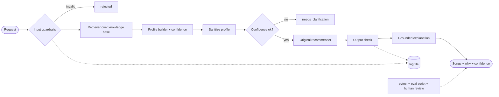

# VibeMatch: A RAG-Powered Music Assistant

**Original project (Modules 1-3): Music Recommender Simulation ("VibeMatch 1.0").**
The original was a small content-based recommender. It stored an 18-song catalog, took a hand-written taste profile (favorite genre, favorite mood, target energy, likes acoustic), scored every song with a weighted rule (genre +2.0, mood +1.5, energy up to +2.0, acoustic fit up to +1.0, max 6.5) and printed the top 5 with a reason for each score. It could only run for profiles a developer typed into `main.py`.

## Title and Summary

**VibeMatch** now lets a person simply *say* what they want ("music for studying late at night", "I'm at the gym, need something hype"). The system **retrieves** relevant notes from a small music knowledge base, uses them to build the taste profile, runs the original recommender, and **explains the result using the retrieved notes as sources**. It also checks its own inputs and outputs, reports a confidence score, logs every request, and is covered by automated tests and an evaluation script.

Why it matters: recommenders usually hide how they decide. Here every answer shows the evidence it used (which knowledge-base chunk, which words in the request) and says so when it is unsure, instead of confidently guessing.

## Architecture Overview

The diagram source is in [`diagrams/architecture.mmd`](diagrams/architecture.mmd) (PNG export: [`assets/architecture.png`](assets/architecture.png)).



| Component | File | Job |
|---|---|---|
| Knowledge base | `data/knowledge/music_knowledge.md` | 28 chunks: 13 situations (studying, workout, night drive...) and 15 genre notes, each with metadata (genre, mood, energy, acoustic) and a citable `note:` |
| Retriever | `src/knowledge.py` | Keyword + stemming match, returns chunks only if a real keyword hits |
| Profile builder | `src/profile_builder.py` | Combines explicit words in the request with retrieved hints; explicit wins. Computes a confidence score |
| Guardrails | `src/guardrails.py` | Validates input, clamps energy, flags unknown genres, checks output ordering/range |
| Recommender | `src/recommender.py` | The original Module 3 scoring logic, unchanged |
| Explainer | `src/explainer.py` | Builds the explanation from score reasons plus the cited KB note. Optional Gemini rewrite with a grounding check |
| Pipeline | `src/pipeline.py` | Orchestrates everything and writes `logs/vibematch.log` |
| CLI | `src/cli.py` | `python -m src.cli "..."` |
| Evaluation | `evals/evaluate.py` | 16 scripted checks, writes `evals/results.md` |

**Where RAG changes behavior:** the retrieved chunk decides the genre, mood, energy and acoustic preference when the user did not state them. "Gym" and "studying" lead to different profiles and different songs only because of what was retrieved (see `test_retrieval_changes_the_recommendations`). The explanation text is also taken from the retrieved chunk, not invented.

## Setup Instructions

Requires Python 3.9+. No API key is needed.

```bash
git clone https://github.com/marcosdvs04/applied-ai-system-final.git
cd applied-ai-system-final
python3 -m venv venv && source venv/bin/activate     # Windows: venv\Scripts\activate
pip install -r requirements.txt

python -m src.cli "music for studying late at night"   # one request
python -m src.cli                                      # interactive mode
python -m pytest -q                                    # 27 tests
python -m evals.evaluate                               # reliability report -> evals/results.md
python -m src.main                                     # original Module 3 demo (7 fixed profiles)
```

Optional: set `GEMINI_API_KEY` (and optionally `GEMINI_MODEL`) in your shell and add `--llm` to polish the explanation. If the key is missing, the call fails, or the reply mentions anything not in the source text, the system silently uses the offline explanation. The LLM can never change the ranking. This optional path was written to be safe but I did not run it against the live API, so treat it as untested.

## Sample Interactions

Real output, copied from `evals/sample_runs.txt` (generated by running the commands shown).

**1. Situation only (RAG fills in every field)**

```
$ python -m src.cli "music for studying late at night"
Status: ok   Confidence: 0.75
Profile: genre=lofi, mood=focused, energy=0.40, acoustic=True
  evidence: retrieved 'Situation: studying and coding' (score 2.0)
  evidence: genre: 'lofi' from 'Situation: studying and coding'
Why: Steady, low-energy, mostly instrumental music keeps attention on the task without grabbing it. Lofi with a slow tempo is the classic choice. [KB: Situation: studying and coding] Top pick ...: Focus Flow by LoRoom (score 6.28).
1. Focus Flow - LoRoom (lofi/focused) score 6.28/6.5
     because: genre match (+2.0); mood match (+1.5); energy 0.40 vs target 0.40 (+2.00); acoustic fit (+0.78)
2. Library Rain - Paper Lanterns (lofi/chill) score 4.66/6.5
3. Midnight Coding - LoRoom (lofi/chill) score 4.63/6.5
```

**2. Request words override retrieved hints**

```
$ python -m src.cli "I'm at the gym, need something hype"
Status: ok   Confidence: 1.00
Profile: genre=pop, mood=energetic, energy=0.90, acoustic=False
  evidence: genre: 'pop' from 'Situation: working out'
  evidence: mood: 'energetic' stated in the request
1. Gym Hero - Max Pulse (pop/intense) score 4.83/6.5
2. Sunrise City - Neon Echo (pop/happy) score 4.50/6.5
3. Concrete Verses - Kid Meridian (hip hop/energetic) score 3.98/6.5
```

**3. Something the catalog cannot satisfy (guardrail + honest confidence)**

```
$ python -m src.cli "k-pop dreamy"
Status: low_confidence   Confidence: 0.30
Profile: genre=k-pop, mood=moody, energy=0.50, acoustic=False
1. Night Drive Loop - Neon Echo (synthwave/moody) score 3.28/6.5
! Genre 'k-pop' is not in the catalog, so it can't earn genre points.
```

**4. Gibberish (refuses to guess)**

```
$ python -m src.cli "asdf qwer"
Status: needs_clarification   Confidence: 0.00
! I couldn't tell what you want. Try a situation (studying, workout, night drive), a genre (jazz, edm) or a mood (sad, happy).
```

## Reliability and Guardrail Results

Full outputs: [`evals/results.md`](evals/results.md), [`evals/pytest_output.txt`](evals/pytest_output.txt), [`evals/sample_runs.txt`](evals/sample_runs.txt).

**Summary: 27 of 27 pytest tests pass. 16 of 16 scripted evaluation checks pass. Average confidence on answered requests: 0.78 (min 0.30, max 1.00).**

| Test input | Evaluation criterion | Status | Confidence | Result |
|---|---|---|---|---|
| `music for studying` | Top song is lofi | ok | 0.75 | Pass |
| `I'm at the gym` | Top song energy >= 0.9 | ok | 0.75 | Pass |
| `party tonight` | Top song is edm | ok | 0.75 | Pass |
| `rainy sad afternoon` | Top song is folk or classical | ok | 1.00 | Pass |
| `night drive` | Top song is synthwave | ok | 1.00 | Pass |
| `coffee shop vibes` | Top song is jazz | ok | 0.88 | Pass |
| `I am so angry` | Top song is metal | ok | 0.82 | Pass |
| `romantic dinner date` | Top song is r&b | ok | 1.00 | Pass |
| `reggaeton para bailar` | Top song is reggaeton | ok | 0.82 | Pass |
| `jazz` | Genre-only input works, flagged low confidence | low_confidence | 0.30 | Pass |
| `edm with energy 1.5` | Out-of-range energy clamped to 1.0 | ok | 0.55 | Pass |
| `k-pop` | Unknown genre flagged, no crash | needs_clarification | 0.00 | Pass |
| `asdf qwer zxcv` | Gibberish asks for clarification | needs_clarification | 0.00 | Pass |
| *(empty)* | Rejected | rejected | 0.00 | Pass |
| *(400 x characters)* | Rejected | rejected | 0.00 | Pass |
| `study music, no acoustic` | Explicit "no acoustic" overrides KB hint | ok | 0.79 | Pass |

Guardrails in the code: input validation (empty, non-text, over 300 characters), energy clamping with a warning, unknown genre/mood warnings, a confidence gate (below 0.30 the system asks instead of recommending), an output check (sorted, in range, non-empty), a safety net around profile building, and a log line for every request in `logs/vibematch.log` (not committed, regenerated on each run).

## Design Decisions and Trade-offs

- **Keyword retrieval instead of embeddings or a vector database.** With 28 short chunks, embeddings would add a dependency, a cost and an API key while making it harder to see why a chunk was retrieved. Keyword matching is fully transparent and testable. The trade-off: it misses synonyms I did not list (for example "bedtime" works because I added it, "lullaby" does not).
- **Explicit words beat retrieved hints.** If someone says "studying but I want metal", they get metal with the focused mood from the retrieved note. Retrieval fills gaps; it never overrides the user.
- **Reuse the original recommender unchanged.** The new layers only produce a profile and explain the result, so every earlier test still passes and the scoring stays easy to reason about.
- **LLM is optional and last.** The system works fully offline. An LLM may only rephrase the explanation and is checked against the source text, so it cannot change which songs are recommended.
- **Confidence is a simple, explainable number**: weighted share of the four profile fields that have evidence (explicit = 1.0, retrieved = 0.5-1.0 by match strength, default = 0). It is a heuristic, not a calibrated probability.

## Testing Summary

What worked: situation and genre requests produce the expected top song, explicit words override retrieved hints, bad input is rejected or clamped instead of crashing, and logging captures each decision.

What did not work at first: the evaluation script caught that `k-pop` was silently ignored, because the genre detector only knew genres in the catalog, so the system said "needs clarification" without telling the user why. I added a list of real genres the catalog lacks so they are recognized and flagged. A second finding: a stated but unsupported genre still counted as full evidence, so `k-pop dreamy` showed confidence 0.60. I changed it to count as zero evidence, and confidence dropped to 0.30.

What I learned: guardrails and tests found problems my demo runs never did, and a confidence number is only useful if it can go down for the right reasons.

## Reflection

This project taught me that the useful part of an AI system is often the code around the model: deciding what evidence to retrieve, what to trust when sources disagree, when to refuse, and how to show the evidence. Making the Module 3 recommender talk in natural language took less work than making it admit when it did not understand. The ethics, limitations and AI-collaboration notes are in [`model_card.md`](model_card.md).

## Portfolio

- Code: https://github.com/marcosdvs04/applied-ai-system-final
- **What this project says about me as an AI engineer:** I build AI features that can show their evidence and say "I'm not sure." I reuse working code instead of rewriting it, test the failure cases on purpose, and treat guardrails, logging and honest evaluation as part of the feature rather than an afterthought.

## Project Structure

```
applied-ai-system-final/
├── README.md              model_card.md
├── assets/architecture.png
├── diagrams/architecture.mmd         (Mermaid source)
├── data/songs.csv                    data/knowledge/music_knowledge.md
├── src/   recommender.py  knowledge.py  profile_builder.py  guardrails.py
│          explainer.py  pipeline.py  cli.py  main.py
├── tests/ test_recommender.py  test_knowledge.py  test_guardrails.py  test_pipeline.py
├── evals/ evaluate.py  results.md  sample_runs.txt  pytest_output.txt
└── logs/  (runtime log, not committed)
```
